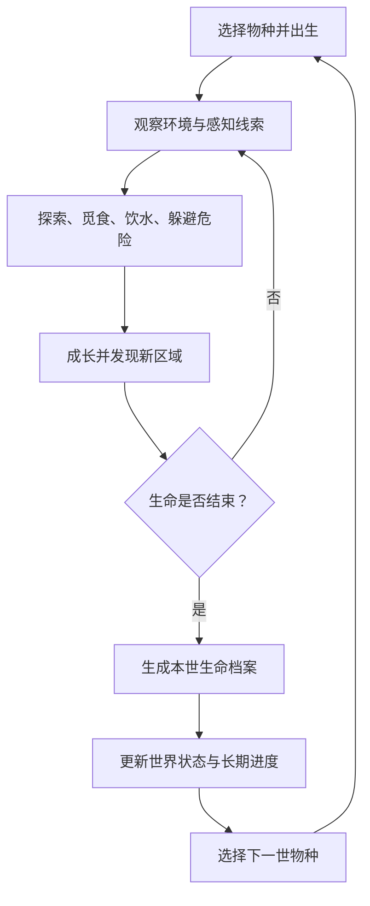
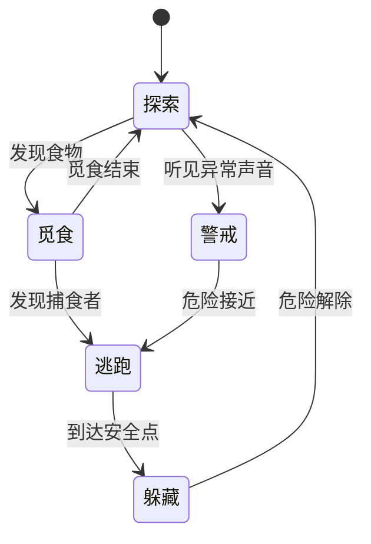

# 《轮生 Reborn》游戏策划案 v1.0

> **项目类型：** PC 单机 3D 开放世界生态生存游戏  
> **文档版本：** v1.0  
> **目标平台：** Windows PC  
> **推荐引擎：** Unreal Engine 5  
> **建模工具：** Blender  
> **当前阶段：** 创意验证与首个可玩版本规划  
> **文档定位：** 项目总策划案，作为后续系统设计、资产制作和开发任务拆分的基准

---

## 0. 策划案摘要

本项目的核心创意是：**玩家可以重生为不同物种，以第一人称沉浸视角探索同一个共享生态世界，并在每一世中体验不同的生存方式。**

第一版不追求庞大的世界和大量物种，而是先制作一块能够完整游玩的生态区域，验证三个关键点：

- 第一人称动物视角能够带来区别于人类的沉浸体验。
- 不同物种在同一环境中，具有不同的感知、移动、觅食与生存规则。
- 死亡与重生能够自然衔接，长期探索进度能够跨越不同生命保留。

### 项目基本信息

| 项目 | 规划 |
|---|---|
| 游戏名称 | 轮生 Reborn（暂定名） |
| 目标平台 | Windows PC |
| 游戏模式 | 单机离线优先 |
| 视觉风格 | 精致、自然、适度简化 |
| 玩家视角 | 第一人称沉浸 |
| 核心玩法 | 探索、生存、轮回 |
| 世界结构 | 同一世界，不同物种共享生态 |
| 推荐引擎 | Unreal Engine 5 |
| 建模与动画工具 | Blender |
| 项目规模原则 | 先做小而完整的体验，再逐步扩展物种、区域和生态关系 |

## 1. 游戏概述

### 1.1 游戏背景与世界观

玩家不扮演人类，而是进入一个由多种生命共同构成的自然世界。

这里没有传统意义上必须完成的主线任务。每种生命都有自己的需求、能力和生存困境。玩家需要观察环境、寻找资源、发现规律，并决定如何度过这一生。

在一世结束后，玩家可以选择新的物种。前世的身体、能力与日常需求会消失，但部分探索记录、物种知识和永久解锁可以保留。

世界观不需要复杂的神话或剧情来解释重生。第一版可以将重生作为核心游戏规则，不急于解释其背后的超自然原因。

### 1.2 产品定位

这不是一款传统的动物战斗游戏，也不是单纯的动物观赏模拟器，而是以下体验的结合：

- 开放世界的自由探索。
- 生存游戏中的资源管理与风险决策。
- 动物模拟中的行为和环境适应。
- Roguelite 式的死亡、重开与长期解锁，但不强制随机生成整个世界。

### 1.3 核心设计原则

1. **视角决定体验：** 玩家通过声音、距离、运动方式、遮挡和感知线索认识环境，而不只是看到一个动物模型。
2. **同一世界，不同规则：** 所有物种共享同一套世界状态，但有不同的能力、资源需求和交互权限。
3. **死亡不等于白玩：** 一世结束后，玩家能够回顾经历，保留部分长期进度，并获得重新探索的动力。
4. **所有系统逐步生长：** 先实现可运行的简单规则，再逐渐增加复杂度，避免在可玩原型出现前建设庞大系统。

## 2. 核心玩法设计

### 2.1 核心循环



短循环负责让玩家随时有事可做；一世的成长与死亡负责提供阶段目标；跨世解锁负责形成长期动力。

### 2.2 第一人称控制方式

第一人称是本项目最重要的体验设计之一，也存在一个问题：玩家可能看不到自己控制的动物。

建议采用以下方式：

- 默认隐藏完整身体，但在低头、跳跃、进食时显示鼻尖、爪子或前肢。
- 使用贴近地面的摄像机高度和适合物种的视野范围。
- 通过脚步声、呼吸、耳朵抖动、环境振动等声音和反馈体现动物状态。
- 根据物种改变移动速度、转向惯性、跳跃高度、视角晃动和感知表现。
- 提供视角灵敏度、镜头晃动强度和视野范围设置，降低长时间游玩的不适。

第一版不追求复杂的身体全程可见效果，优先保证移动、转向和交互自然。

### 2.3 基础操作

| 输入 | 默认功能 |
|---|---|
| WASD | 移动 |
| 鼠标 | 观察与转向 |
| Shift | 奔跑或加速 |
| Space | 跳跃，或触发物种专属动作 |
| E | 交互、进食、饮水 |
| Ctrl | 潜伏或降低身体高度 |
| Tab | 查看生存状态和生命记录 |
| Esc | 暂停菜单 |

以上为初步建议，后续需要根据不同物种调整。蚂蚁不应机械地继承猫的跳跃和奔跑操作。

### 2.4 生存系统

第一版只实现四个核心指标：

| 指标 | 作用 | 设计原则 |
|---|---|---|
| 生命值 | 受伤和死亡判定 | 受到攻击、跌落或环境伤害时下降 |
| 饥饿值 | 推动觅食 | 随游戏时间缓慢下降 |
| 体力值 | 限制持续奔跑和部分动作 | 休息后恢复 |
| 水分值 | 推动寻找水源 | 随时间和活动消耗 |

第一版不建议同时引入体温、疾病、复杂营养、情绪、睡眠债务等系统。每项指标都应该服务于玩家决策，而不是成为频繁打卡的负担。

### 2.5 探索系统

游戏不采用传统任务列表作为主要驱动力，而是通过环境和生存需求引导玩家。

玩家可以发现：

- 水源、食物点和安全休息点。
- 可以躲藏的草丛、石缝、树根与洞穴。
- 动物足迹、声音来源和活动区域。
- 不同时间段出现的动物。
- 尚未解锁的区域与物种线索。

探索记录应具有实际用途。例如，发现一个安全水源后，它会被加入地图记录，下一世即使换成其他物种，也可以在符合其能力的前提下重新找到它。

## 3. 物种系统设计

### 3.1 首版物种规划

建议首版先完成一种可玩物种——猫，再加入老鼠作为第二种可玩物种。鸟类先作为生态 NPC，避免一开始同时承担飞行控制、地面控制和两套动画体系。

#### 物种 A：猫（首版必做）

- **定位：** 灵活探索者与机会型捕食者。
- **能力：** 奔跑、跳跃、潜伏、捕猎、休息。
- **主要需求：** 食物、水源、安全休息点。
- **主要风险：** 更大的动物、危险地形和资源不足。
- **核心体验：** 通过听觉与观察寻找猎物，在追逐与安全之间做出选择。

#### 物种 B：老鼠（首版第二阶段）

- **定位：** 警觉型探索者与逃生者。
- **能力：** 快速钻行、进入小型洞穴、短距离冲刺。
- **主要需求：** 可获得的食物、安全藏身处。
- **主要风险：** 猫、鸟类及暴露在开阔地带。
- **核心体验：** 判断危险距离、寻找掩体、利用狭窄通道逃生。

#### 物种 C：麻雀（首版 NPC）

- **定位：** 生态活动者与潜在猎物。
- **行为：** 觅食、停留、受惊飞离。
- 第一版不开放玩家控制。
- 后续可发展为飞行、筑巢、繁殖与迁徙玩法。

### 3.2 物种配置规范

每个物种都应该有独立配置数据，而不是把物种名称写死在各个系统里。

建议为每种动物定义：

- `SpeciesId`：物种唯一标识。
- `MovementProfile`：移动速度、加速度、转向、跳跃或飞行能力。
- `PerceptionProfile`：视觉、听觉和其他感知参数。
- `SurvivalProfile`：食物偏好、水分消耗、体力消耗。
- `InteractionProfile`：可执行的交互行为。
- `AIProfile`：NPC 行为配置。
- `UnlockRule`：成为该物种需要满足的条件。

首版可以用 Unreal Engine 的 Data Asset 或 Data Table 保存配置，避免过早建设复杂的配置管理工具。

### 3.3 感知系统

第一人称沉浸不能只是改变摄像机位置。物种感知应该影响玩家实际获取的信息。

| 感知方式 | 首版处理方式 |
|---|---|
| 视觉 | 根据距离、遮挡和视野判断目标是否可见 |
| 听觉 | 动物动作触发声音事件，玩家根据方向寻找来源 |
| 嗅觉 | 暂不制作完整嗅觉模拟，后续可用简化气味线索表示食物和动物踪迹 |
| 振动 | 暂不实现复杂模拟，后续可用于蚂蚁等特殊物种 |

例如，老鼠可能先听见草丛里的脚步声，再发现猫；猫则需要主动观察、追踪或靠近才能找到老鼠。

## 4. 共享生态系统设计

### 4.1 世界共享内容

不同物种不是进入独立关卡，而是共享同一个世界状态。至少共享：

- 地图与地形。
- 昼夜时间。
- 食物与水源。
- NPC 动物的活动和数量。
- 捕食和逃跑造成的生态变化。
- 已发现的地点与长期探索记录。

第一版不需要完整的自然演化模拟，但要让玩家能观察到行为带来的结果。

### 4.2 NPC 动物 AI

首版建议采用有限状态机，等行为数量增加后再视情况改用行为树。



第一版只要求老鼠具有觅食、警戒、逃跑、躲藏四类行为。鸟类 NPC 可以使用更简单的觅食、停留和受惊飞离状态。

### 4.3 生态数量模拟

为了控制开发量和运行性能，建议使用两层模拟：

- **玩家附近：** 使用实际动物实体、寻路、动画和碰撞。
- **远离玩家的区域：** 使用数量、资源和时间变化等统计数据模拟。

例如，某个区域开始有 10 只老鼠。玩家捕食一只后，该区域的数量减少；经过一段时间，在食物充足、安全条件满足的情况下，数量可能缓慢恢复。

首版先不模拟每只远处老鼠的出生、移动和死亡过程，只需保证统计结果合理，玩家进入区域时生成的动物与当前生态状态一致。

### 4.4 昼夜系统

第一版实现简单昼夜变化即可：

- 白天和夜晚拥有不同的光照。
- 不同时间段可以影响部分 NPC 的活动倾向。
- 夜间能见度降低，听觉线索的重要性上升。
- 玩家可以在安全地点休息，让时间推进。

天气系统、季节和真实气象变化暂不纳入首版。

## 5. 开放世界与地图设计

### 5.1 首张地图：庭院生态区

建议采用约 **300 米 × 300 米** 的紧凑地图作为初始目标。这不是硬性尺寸，可以根据实际移动速度、视野和探索时长调整。

地图由四个主要区域组成：

| 区域 | 主要资源 | 设计目的 |
|---|---|---|
| 庭院 | 容易找到的食物、休息点 | 教学和初始探索 |
| 草地 | 老鼠、昆虫、草丛 | 追逐、潜伏和躲避 |
| 林地 | 遮蔽物、树根、岩石 | 视觉遮挡和探索 |
| 溪流 | 水源、鸟类活动 | 生存需求与生态观察 |

### 5.2 地图设计原则

- 每个区域至少有一种独特的玩法用途。
- 食物、水源与安全点之间应当存在距离，让玩家需要规划路线。
- 地形既能提供遮挡，也会影响动物移动。
- 玩家能够从环境线索中判断潜在风险。
- 地图不能大到需要大量无意义的跑图。

### 5.3 首版暂不制作

- 无限生成的开放世界。
- 大规模室内建筑。
- 多个气候带和生物群落。
- 完整季节变化。
- 复杂的地底洞穴网络。
- 可破坏的整套生态环境。

## 6. 成长、死亡与重生系统

### 6.1 一世的生命周期

首版每个物种都可以有简化的生命阶段：

1. 出生：从安全地点进入世界。
2. 成长：熟悉环境、获取食物、提高生存能力。
3. 成熟：探索更危险的区域，解锁更多行为或地点。
4. 生命结束：因死亡或主动结束本世而进入结算。

第一版可以把成长简化为生存经验和少量能力解锁，不必实现真实动物完整的幼年、成年、繁殖和衰老生理模型。

### 6.2 死亡结算

每一世结束后，展示一张「生命档案」。

建议包含：

- 本世物种和存活时长。
- 探索过的区域。
- 获得的食物数量。
- 发现的地点和生态线索。
- 重要事件，例如成功逃离捕食者。
- 本世解锁的内容。

结算页面不应只有数字统计，而应帮助玩家回顾这一世的经历。

### 6.3 永久进度

| 内容 | 是否跨世保留 | 首版规则 |
|---|---|---|
| 已发现地点 | 是 | 保存探索记录 |
| 物种解锁 | 是 | 满足条件后永久开放 |
| 生命档案 | 是 | 每一世均可查看 |
| 当前生命的饥饿与体力 | 否 | 新生命重新初始化 |
| 当前身体与物种能力 | 否 | 由新物种决定 |
| 局部动物数量 | 部分 | 通过共享生态状态更新 |
| 所有资源和环境状态 | 不完全保留 | 第一版采用有限状态记录 |

### 6.4 如何解锁新物种

第一版建议通过探索和生命经历解锁，而不是要求玩家反复刷经验。

例如：

- 首次发现林地深处的老鼠洞，解锁老鼠。
- 在庭院中观察到一定数量的野生动物，解锁生态图鉴条目。
- 完成一世后，开放生命档案和重生选择。

具体条件和数值需要通过测试调整。

首版不建议使用付费解锁、抽卡或随机物种掉落，以免分散核心体验的注意力。

## 7. 美术、建模与音效规范

### 7.1 视觉方向

推荐「精致但适度简化」：

- 轮廓清晰，动物外形具有辨识度。
- 采用自然的材质与光照，不追求每根毛发都真实。
- 植被、石头、泥土等资产可重复组合。
- 远处环境通过色彩、雾效和层次形成空间感。
- 重点优化第一人称地面高度的视觉效果。

这种风格比完全写实更容易控制模型复杂度，同时能保留自然生态的沉浸感。

### 7.2 Blender 资产规范

建议建立统一的资产制作流程：

1. 在 Blender 中制作低复杂度基础模型。
2. 统一模型朝向、比例和原点位置。
3. 为需要动作的动物制作骨骼。
4. 制作基础动画。
5. 检查 UV、材质和贴图。
6. 导出 FBX，导入 Unreal Engine。
7. 在引擎中验证比例、骨骼、碰撞与动画。

建议的资产目录：

```text
Game/
├── Characters/
│   ├── Cat/
│   │   ├── Model/
│   │   ├── Skeleton/
│   │   ├── Animations/
│   │   └── Materials/
│   ├── Mouse/
│   └── Sparrow/
├── Environment/
│   ├── Terrain/
│   ├── Foliage/
│   ├── Rocks/
│   └── Props/
├── Audio/
├── UI/
└── Data/
```

实际可按 Unreal Engine 的 Content 目录组织。初期先用占位模型把玩法跑通，再逐步替换为正式资产。

### 7.3 第一版动画清单

**猫：**

- 站立与观察。
- 慢走。
- 奔跑。
- 跳跃与落地。
- 潜伏。
- 进食。
- 休息。
- 受伤与死亡。

**老鼠：**

- 站立与观察。
- 移动与冲刺。
- 觅食。
- 惊吓逃跑。
- 躲藏。
- 死亡。

### 7.4 音效规范

首版至少需要：

- 不同地面的脚步声。
- 风、溪流、鸟鸣等环境音。
- 动物移动、受惊和警戒的声音。
- 进食与交互反馈。
- 生命状态提示音。

后续可以根据物种增加听觉方向判断、远近衰减和遮挡效果。

## 8. 技术实现方案

### 8.1 技术栈

| 模块 | 建议方案 |
|---|---|
| 游戏引擎 | Unreal Engine 5 |
| 游戏逻辑 | 蓝图优先，必要时引入 C++ |
| 模型与动画 | Blender |
| 角色控制 | Character 或自定义 Pawn，按物种选择 |
| 动物 AI | AI Controller、导航系统、状态机或行为树 |
| 配置数据 | Data Asset / Data Table |
| 动画控制 | Animation Blueprint |
| 存档 | Unreal SaveGame |
| UI | UMG |
| 版本管理 | Git 或适合大文件的版本控制方案 |

### 8.2 角色架构

建议不要把所有动物的行为都写在一个巨大的蓝图里。可以划分为：

- `BP_AnimalBase`：公共属性、交互入口和基础生命状态。
- `BP_PlayerAnimal`：玩家输入和控制。
- `BP_AnimalAI`：NPC 决策。
- `BP_SpeciesData`：物种配置。
- `BP_SurvivalComponent`：饥饿、体力、生命值。
- `BP_PerceptionComponent`：感知与危险线索。
- `BP_EcologySubsystem`：区域生态状态。
- `BP_LifeCycleSubsystem`：死亡结算与重生。
- `BP_SaveManager`：存档和读取。

这只是逻辑职责划分。第一版可以先实现少量蓝图，等功能稳定后再拆分，避免零基础阶段被架构本身拖住。

### 8.3 性能策略

- 只在玩家附近运行完整动物 AI。
- 远处动物采用低频更新或统计模拟。
- 限制同时活动的 NPC 数量。
- 尽量复用环境模型和材质。
- 先使用简单碰撞体，避免所有物体都采用复杂碰撞。
- 在真实运行场景中持续测量帧率和内存，而不是只在空地图里测试。

### 8.4 存档策略

建议保存：

- 当前物种、位置、生命状态。
- 已发现地点和永久解锁。
- 生命档案。
- 关键区域生态统计。
- 当前世界时间与必要的资源状态。

不要把所有动物的每一个 AI 状态都永久写入存档。这样既没有必要，也会让数据维护变得困难。

## 9. UI 与交互设计

### 9.1 游戏内 HUD

UI 的目标是辅助沉浸，而不是把画面变成复杂的生存仪表盘。

首版 HUD 只保留：

- 生命状态。
- 饥饿和体力。
- 时间与区域提示。
- 必要的交互信息。

水分可以在需要时显示，或者通过更简洁的状态提示表达。

### 9.2 必须制作的 UI 页面

1. 主菜单。
2. 物种选择。
3. 游戏内 HUD。
4. 暂停菜单。
5. 生命档案。
6. 死亡结算。
7. 重生确认。
8. 设置页面。
9. 存档读取与错误提示。

第一版不需要大型背包、复杂技能树、任务追踪器或社交系统。

## 10. 首版范围与后续规划

### P0：首版必做

- 一张小型生态地图。
- 第一人称猫角色控制。
- 基础生存、觅食、饮水与休息。
- 老鼠 AI 和基础捕食关系。
- 基础昼夜变化。
- 死亡结算、重生和存档。
- 第二可玩物种老鼠。
- 基础声音、UI 和操作设置。

**目标：** 完成一段完整、可重复游玩的游戏体验。

### P1：后续扩展

- 麻雀等更多生态 NPC。
- 更丰富的听觉、嗅觉与追踪系统。
- 繁殖、幼年和衰老。
- 更多可玩物种。
- 生态数量与资源的动态变化。
- 天气、季节与更大的地图。
- 生命故事与跨世线索。

### 暂不开发

- 多人联机与共享服务器。
- 无限程序化世界。
- 完整的全物种生态模拟。
- 实时 AI 大模型驱动所有动物。
- 完整的生物繁殖与遗传算法。
- 复杂的建造、制作和交易系统。
- 数十种可玩物种同步上线。

第二物种不是简单地换一套模型，而是要能体现明显不同的玩法。如果猫和老鼠的操作、感知与生存体验几乎一样，就不应急着继续增加物种。

## 11. 开发里程碑与验收标准

对于零基础开发者，建议按可验证的阶段推进。每个阶段都应该有一个能运行的成果，而不是连续几周只写文档或只制作模型。

| 阶段 | 主要任务 | 完成标准 |
|---|---|---|
| M0：项目准备 | 安装 Unreal、Blender，建立项目与版本管理 | 能打开工程并运行空场景 |
| M1：移动原型 | 第一人称相机、移动、跳跃、碰撞 | 能在测试地图里自然移动 |
| M2：生存原型 | 饥饿、体力、交互、觅食 | 能完成基本生存循环 |
| M3：生态原型 | 老鼠 AI、警戒、逃跑、躲藏 | 动物能根据玩家行为作出反应 |
| M4：生命循环 | 死亡、结算、重生、存档 | 能完整结束并重新开始一世 |
| M5：第二物种 | 独立移动、感知与生存规则 | 两种生命有明显玩法差异 |
| M6：体验打磨 | UI、音效、性能、操作优化 | 能连续游玩并恢复存档 |

### 首版最终验收清单

- [ ] 可以从主菜单开始新游戏。
- [ ] 猫的移动与第一人称视角正常。
- [ ] 能够找到食物和水源。
- [ ] 老鼠会觅食并对危险作出反应。
- [ ] 捕食或危险能够影响生命状态。
- [ ] 死亡后可以查看本世记录。
- [ ] 能够选择另一物种并重新出生。
- [ ] 重启游戏后长期进度能够恢复。
- [ ] 不同物种的移动或感知规则确实不同。
- [ ] 运行过程中没有阻断流程的严重问题。

## 12. 风险管理

| 风险 | 解决方式 |
|---|---|
| Blender 学习时间过长 | 先做低复杂度模型，核心资产允许使用合法授权资源 |
| 第一人称缺乏动物感 | 重点打磨移动、地面高度、声音与感知反馈 |
| 动物 AI 难度过高 | 先做有限状态机，再逐步增加行为 |
| 共享生态太复杂 | 第一版只模拟少数关键关系与区域统计 |
| 功能范围不断膨胀 | 每个新增功能都必须说明它对核心体验的价值 |
| 玩法不够有趣 | 尽早让其他人试玩，而不是等画面完成后再验证 |
| 项目难以持续维护 | 使用版本控制，保留可运行版本，定期备份 |

## 13. 项目目录与文档管理

除了游戏工程本身，建议建立一个独立的策划文档目录：

```text
Reborn/
├── Docs/
│   ├── GDD_v1.0.md
│   ├── CoreGameplay.md
│   ├── SpeciesDesign.md
│   ├── EcologySystem.md
│   ├── WorldDesign.md
│   ├── TechnicalDesign.md
│   ├── AssetPipeline.md
│   └── Milestones.md
├── Art/
│   ├── Blender/
│   ├── References/
│   └── Exports/
└── Game/
    └── UnrealProject/
```

其中，`GDD_v1.0.md` 是总策划案，其余文档负责具体系统。

初期不必一次性填满所有文档。总策划案先记录方向，只有当某个系统即将开始开发时，才需要将它细化为具体规则和实现要求。

## 14. 第一周行动计划

考虑到项目开发经验尚在积累，第一周的目标不是做出完整动物，而是建立可运行的最小项目。

### 第 1 天：安装与熟悉工具

- 安装 Unreal Engine 5 和 Blender。
- 创建一个空白测试项目。
- 确认工程可以正常运行。

### 第 2 天：制作测试环境

- 使用基础地形、立方体、斜坡和障碍物搭建小场景。
- 测试空间尺度。
- 暂时不急着制作树木和草地。

### 第 3 天：确定猫的移动手感

- 调整相机高度、视野、移动速度、加速度、转向与跳跃。
- 先用临时模型验证第一人称体验。

### 第 4～5 天：尝试 Blender 到 Unreal 的资产流程

- 制作一个简单的猫模型。
- 完成基础材质与导出。
- 确认导入后比例、朝向、碰撞正常。
- 复杂骨骼动画可以先使用占位资源。

### 第 6～7 天：建立第一个可玩原型

- 将移动、相机、测试环境和动物模型组合起来。
- 录制实际运行视频。
- 记录还不自然的地方。

这只是建议的学习顺序，并不要求必须在七天内完成。如果某个步骤还不熟悉，就继续把它做好，再进入下一步。

## 15. 项目成功标准与最终决策

判断项目是否值得继续投入，可以用一个简单标准：

> **当玩家从猫重生为老鼠时，他是否会因为世界没有改变、但自己的处境完全改变，而产生探索欲？**

如果答案是肯定的，就找到了这个游戏的核心价值。

如果答案是否定的，那么无论模型有多精致、地图有多大，都应该先回头改进物种差异、感知方式和生态关系。

### v1.0 开发原则

- 先完成一张小地图，而不是一个大世界。
- 先完成猫的完整生命循环，而不是十种动物的半成品。
- 先让老鼠真正成为不同的生命，而不是换一套外观。
- 先让死亡和重生有意义，再扩展成长、繁殖和跨世故事。
- 先验证游戏是否有趣，再投入大量时间制作精细资产。

**本策划案作为项目基准版本。** 后续每当准备开始一个系统，就从这份方案中拆出具体需求、技术实现和验收标准。这样即使是第一次做游戏，也能够逐步推进，而不是一开始就被庞大的开放世界目标压垮。
